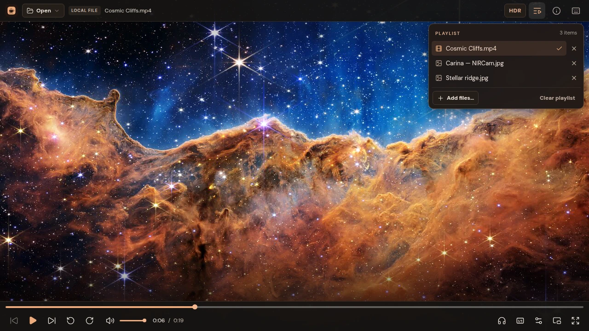

<p align="center">
  
</p>
<h1 align="center">Kahve Player</h1>
<p align="center">Ridiculysly fast and capable <strong>Video</strong>, <strong>Photo</strong> and <strong>Music</strong> Player based on Chrome</p>
<p align="center"><a href="https://arazgray.github.io/kahve-player/"><strong>Open Kahve in Chrome →</strong></a></p>

I was tired of HDR challenges in Linux, recently findouts that chrome has support for it, and it plays heavy videos much easier than VLC or other stuff. So I made this for myself.



<sub>Screenshot: Webb’s <a href="https://esawebb.org/images/weic2205a/">Cosmic Cliffs in Carina</a>. Credit: NASA, ESA, CSA, and STScI. The media shown is not bundled with the app.</sub>

## Bring your own media

Kahve opens to an empty player with **Open Files**, **Open Streams**, and a disabled **Open IPTV** button for future support. Drop in videos, music, photos, or a mix. The files stay on your device.

- **Build a queue.** Dropping media during playback replaces the active queue and opens the dropped media immediately. To append without interrupting playback, use **Open → Add files to queue**. **Save** and **Load** keep named playlists, including copies of their local files, in this browser. They don’t sync across devices and can be removed from the **Load** screen.
- **Play music.** Kahve shows embedded cover art when available. With or without art, it shows the track, artist, and album from the file’s tags.
- **Browse images.** Videos and music advance when they finish; images wait for you and crossfade as you move between them. If you open one image, press **Previous** or **Next** and choose its containing folder when Chrome asks. Kahve then browses that folder’s images in filename order.
- **Open a stream.** Paste an HLS, DASH, or direct video URL through the **Open** menu. Adaptive streams can expose audio and subtitle tracks, automatic or manual quality, and a choice of HDR or SDR renditions.
- **Make it watchable your way.** Add `.srt` or `.vtt` subtitles, adjust playback speed, or use fullscreen or picture-in-picture. The **Info** button shows available codec, frame rate, resolution, and other media details.

Press `O` to open files, `Space` to play or pause, `[` / `]` to move through the queue, `Enter` to switch fullscreen, and `?` to see all shortcuts.

## Put a cup on your desktop

1. Open [Kahve Player](https://arazgray.github.io/kahve-player/) in desktop Chrome.
2. Use **Install** when offered, or use Chrome’s install option in the address bar or menu.
3. In the installed window, click Chrome’s **Hide title bar** chevron if it appears. Kahve’s toolbar and the native window controls then share one row.

Open Kahve once while online so Chrome can cache the app and all its bundled assets. After that, the installed app and browser page can open local media, inspect metadata, and load saved local playlists offline. Remote stream URLs still need a connection.

<details>
<summary>Codec, HDR, and streaming limits</summary>

Kahve uses Chrome’s media engine, so codec and HDR output depend on the browser, OS, graphics hardware, and display. The HDR menu selects an available stream rendition; it does not force HDR for a local file or direct link. Chrome may not expose separate embedded audio tracks in local files. Cross-origin HLS and DASH need a server that allows browser access. Kahve doesn’t transcode media or configure DRM licenses.

</details>

## Run from source

Use Node.js 24 and npm:

```sh
npm ci
npm run dev
```

Open [localhost:5173](http://localhost:5173/). To test installation or offline playback, run `npm run build` followed by `npm run preview` and open [localhost:4173](http://localhost:4173/). Run `npm test` with desktop Chrome installed for the browser test suite.

The player is built with Vite, the browser’s native video element, hls.js, Shaka Player, and MediaInfo. Pushes to `main` build and deploy the static app through [GitHub Actions](.github/workflows/pages.yml).
